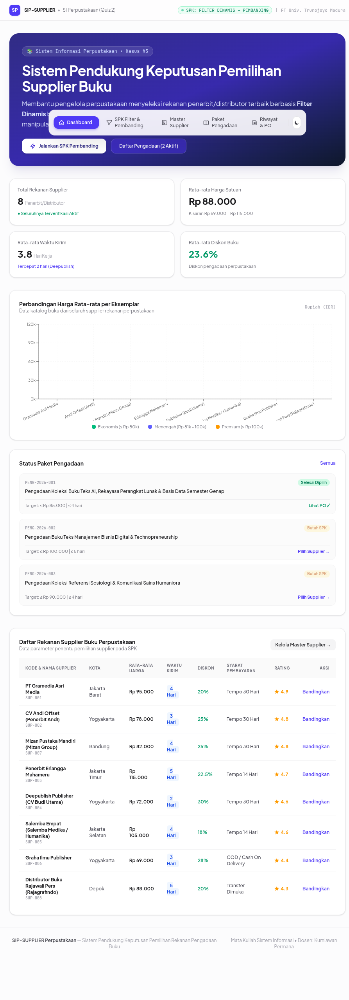
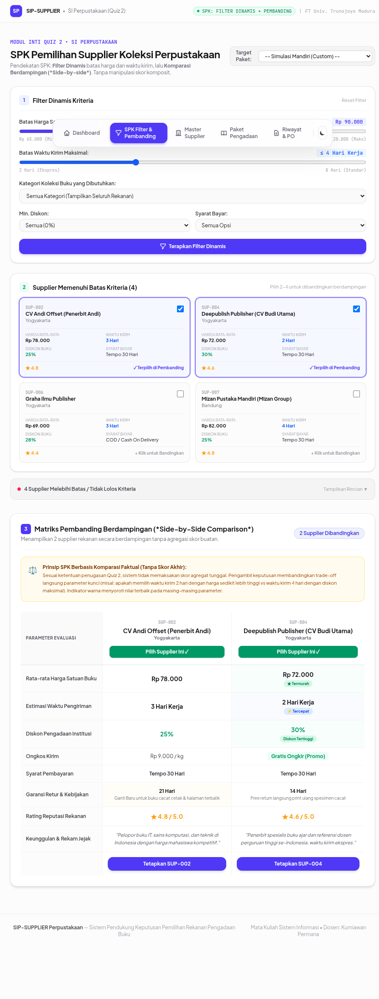
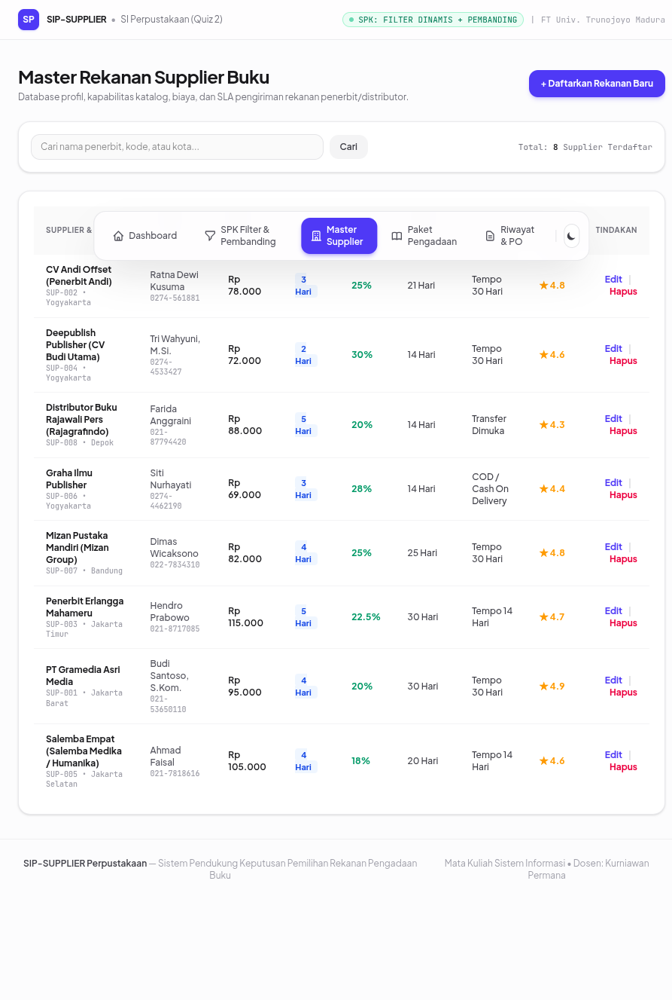
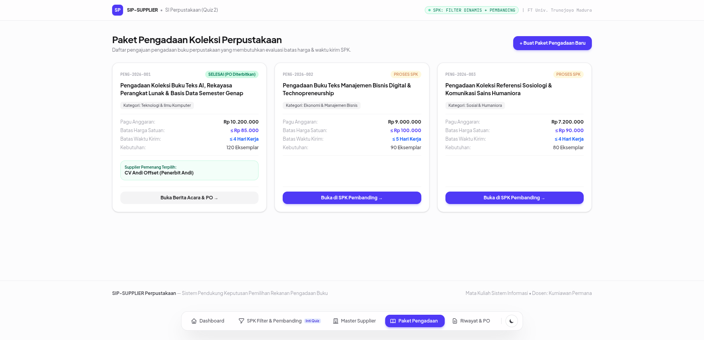
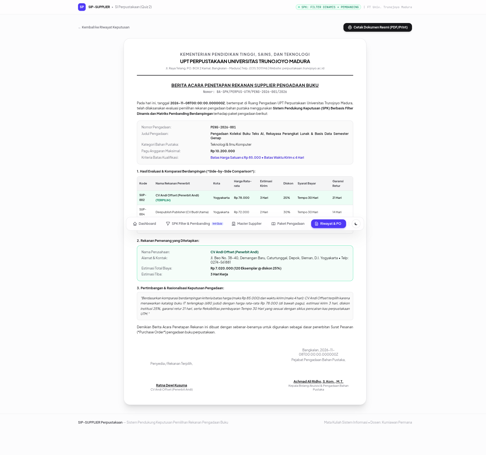

# DOKUMEN TUGAS QUIZ 2 — SISTEM INFORMASI

## DOKUMENTASI TANGKAPAN LAYAR (SCREENSHOT) TAMPILAN APLIKASI SPK

---

### IDENTITAS PENUGASAN

* **Mata Kuliah:** Sistem Informasi
* **Dosen Pengampu:** Kurniawan Permana
* **Kelompok:** SI Perpustakaan (Kasus #3 — Pemilihan Supplier Pengadaan Buku)
* **Kasus:** Pemilihan Supplier Koleksi Bahan Pustaka
* **Pendekatan SPK:** Filter Dinamis + Pembanding Berdampingan (*Side-by-Side Comparison*)
* **Penyusun:** Achmad Ali Ridho (NIM: 230411100197)
* **Program Studi:** Sistem Informasi, Fakultas Teknik, Universitas Trunojoyo Madura

---

### PENGANTAR DOKUMENTASI VISUAL

Dokumen ini memuat dokumentasi visual tangkapan layar (*screenshot*) asli dari seluruh antarmuka aplikasi **SIP-SUPPLIER: Sistem Informasi Perpustakaan & SPK Pemilihan Supplier Buku** yang telah diuji secara langsung pada peramban web (*web browser*).

Sistem mengimplementasikan seluruh kebutuhan studi kasus #3 secara tepat sasaran:
1. **Pengguna menentukan batas harga dan waktu kirim secara dinamis:** Diwujudkan melalui panel slider dan kontrol parameter interaktif.
2. **Membandingkan supplier berdampingan secara objektif:** Diwujudkan melalui matriks perbandingan kolom demi kolom (*head-to-head comparison*).
3. **Tidak ada skor akhir buatan:** Sistem menyajikan perbandingan data faktual murni dengan visual highlight pada parameter unggulan tanpa pemaksaan skor tunggal tertimbang, sehingga keputusan akhir berada di tangan pejabat pengadaan berdasarkan pertimbangan rasional.

---

### TANGKAPAN LAYAR 1: DASHBOARD EKSEKUTIF & ANALITIK REKANAN

#### Deskripsi Fitur:
1. **Hero Banner & Orientasi Kasus:** Menjelaskan fokus sistem informasi pada penanganan Kasus #3 (Pemilihan Rekanan Supplier Koleksi Bahan Pustaka) berbasis filter dinamis dan komparasi berdampingan.
2. **Kartu Indikator Kinerja Utama (KPI):**
   * *Total Rekanan Supplier:* 8 Penerbit/Distributor nasional aktif terverifikasi.
   * *Rata-rata Harga Satuan:* Rp 88.000 (kisaran Rp 69.000 – Rp 115.000).
   * *Rata-rata Waktu Pengiriman:* 3.8 Hari Kerja (tercepat 2 hari kerja).
   * *Rata-rata Diskon Pengadaan:* 23.6% potongan harga institusi.
3. **Grafik Komparasi Harga Koleksi (Recharts):** Grafik batang interaktif yang memvisualisasikan disparitas harga rata-rata antar rekanan penerbit, dengan pengelompokan warna (Hijau: Ekonomis ≤ Rp 80k, Biru: Menengah Rp 81k–100k, Kuning: Premium > Rp 100k).
4. **Widget Paket Pengadaan Aktif:** Memperlihatkan antrean paket pengadaan buku yang mendesak untuk dievaluasi melalui SPK.
5. **Tabel Ringkasan Rekanan:** Menampilkan identitas supplier, domisili gudang, rata-rata harga, estimasi waktu kirim, syarat pembayaran, dan rating kepatuhan.

---

### TANGKAPAN LAYAR 2: MODUL INTI SPK — FILTER DINAMIS & MATRIKS PEMBANDING BERDAMPINGAN

#### Deskripsi Fitur & Alur Pengambilan Keputusan:
1. **Panel Kontrol Filter Dinamis (Kiri):**
   * *Target Paket Pengadaan:* Dropdown pemilihan paket kebutuhan buku perpustakaan yang secara otomatis mengisi nilai batas kriteria awal.
   * *Slider Batas Harga Satuan Maksimal:* Kontrol rentang harga interaktif (misal: disetel pada batas maksimal Rp 90.000/eksemplar).
   * *Slider Batas Waktu Kirim Maksimal:* Kontrol rentang hari pengiriman (misal: disetel pada batas maksimal ≤ 4 hari kerja).
   * *Filter Bidang Kategori Koleksi:* Penyaringan berdasarkan spesialisasi buku (Teknologi & Komputer, Sains, Ekonomi, Humaniora, dll.).
   * *Filter Syarat Pembayaran & Min. Diskon:* Filter fleksibilitas termin kredit (Tempo 30 Hari vs Tunai).
2. **Panel Status Kualifikasi Supplier (Kanan Atas):**
   * Menampilkan daftar supplier yang **Memenuhi Seluruh Batas Kriteria** secara real-time.
   * Checkbox interaktif untuk memilih 2 hingga 4 supplier rekanan yang hendak dikomparasi secara berdampingan.
   * Terdapat *collapsible drawer* yang mencatat rincian supplier yang **Gugur / Melebihi Batas Kriteria** beserta penjelasan transparannya (contoh: harga melebihi batas atau waktu kirim terlalu lama).
3. **Matriks Pembanding Berdampingan (*Side-by-Side Comparison*) (Bawah):**
   * **Banner Prinsip SPK Non-Skoring:** Memberikan penegasan bahwa sistem tidak menggunakan skor matematis komposit, melainkan menyajikan komparasi transparan.
   * Tabel komparasi menampilkan kolom rekanan terpilih berdampingan.
   * **Visual Highlight Parameter Terbaik:**
     * Lencana Hijau (*Termurah*) untuk harga per eksemplar paling hemat.
     * Lencana Biru (*Tercepat*) untuk waktu pengiriman paling singkat.
     * Lencana Diskon Tertinggi untuk rekanan dengan rabat paling menguntungkan kas perpustakaan.
     * Lencana Garansi Terpanjang untuk perlindungan retur buku cacat fisik paling aman.
4. **Tombol Eksekusi Pemilihan ("Pilih Supplier Ini"):**
   * Membuka modal konfirmasi penetapan pemenang, pengisian nama pejabat pengadaan, dan perekaman rasionalisasi pertimbangan trade-off keputusan.

---

### TANGKAPAN LAYAR 3: MASTER DATA REKANAN SUPPLIER BUKU (CRUD)

#### Deskripsi Fitur:
1. **Pencarian Real-Time & Filter Cepat:** Pengguna dapat mencari rekanan berdasarkan nama badan usaha, kode supplier, kota asal gudang, maupun kontak person.
2. **Katalog Parameter Lengkap:** Menampilkan seluruh dimensi data supplier (kode identifikasi, nama rekanan, kota, nomor telepon/surel, rata-rata harga, estimasi waktu kirim, persentase diskon institusi, masa garansi retur, syarat termin pembayaran, dan rating reputasi).
3. **Operasi CRUD Lengkap:**
   * Tombol *+ Daftarkan Rekanan Baru* untuk menambahkan data distributor baru melalui modal formulir tervalidasi.
   * Aksi *Edit* untuk memperbarui profil rekanan, perubahan tarif harga, maupun penyesuaian durasi pengiriman.
   * Aksi *Hapus* untuk menghapus atau menonaktifkan rekanan yang sudah tidak bekerja sama.

---

### TANGKAPAN LAYAR 4: MANAJEMEN PAKET PENGADAAN KOLEKSI BUKU

#### Deskripsi Fitur:
1. **Daftar Kartu Paket Pengadaan:** Memvisualisasikan seluruh paket belanja koleksi bahan pustaka perpustakaan.
2. **Parameter Plafon Kebutuhan:**
   * Nomor unik paket pengadaan (contoh: PENG-2026-001, PENG-2026-002, PENG-2026-003).
   * Kategori bahan pustaka yang diadakan.
   * Total Pagu Anggaran yang disahkan universitas.
   * Batas Maksimal Harga Satuan (Plafon SPK).
   * Batas Maksimal Waktu Tiba (Target kesiapan buku sebelum perkuliahan dimulai).
   * Estimasi kuantitas eksemplar yang dibutuhkan.
3. **Status Siklus Pengadaan:**
   * Status beranimasi *PROSES SPK* untuk paket yang menunggu pemilihan supplier melalui sistem pendukung keputusan.
   * Status *SELESAI (PO Diterbitkan)* lengkap dengan nama rekanan pemenang yang telah disahkan.
4. **Tombol Pintas Terintegrasi:**
   * Tombol *Buka di SPK Pembanding* yang langsung mengarahkan ke modul SPK dengan kriteria batas harga dan hari kirim yang terisi secara otomatis.
   * Tombol *Buka Berita Acara & PO* untuk mencetak dokumen pengesahan resmi.

---

### TANGKAPAN LAYAR 5: DOKUMEN RESMI BERITA ACARA PENETAPAN & SURAT PESANAN (PO)

#### Deskripsi Fitur:
1. **Format Dokumen Kedinasan Resmi:**
   * Kop surat resmi UPT Perpustakaan Universitas Trunojoyo Madura.
   * Nomor register Berita Acara resmi kedinasan.
   * Judul: *BERITA ACARA PENETAPAN REKANAN SUPPLIER PENGADAAN BUKU*.
2. **Rincian Evaluasi & Matriks Kandidat:**
   * Mencantumkan tabel ringkasan supplier rekanan yang telah dikomparasi secara berdampingan pada proses SPK.
   * Menandai supplier rekanan yang ditetapkan sebagai pemenang (*TERPILIH*).
3. **Klausul Rasionalisasi Keputusan (Audit Trail):**
   * Menampilkan narasi pertimbangan objektif pejabat pengadaan mengenai alasan pemilihan supplier tersebut di antara pembanding yang ada (misal: pertimbangan keandalan waktu tiba demi mengejar kalender akademik, kesesuaian harga terhadap pagu, dan fleksibilitas pembayaran tempo 30 hari).
4. **Estimasi Nilai Pengadaan & Klausul Garansi:**
   * Menghitung total nilai kontrak pengadaan bersih setelah pemotongan diskon institusi.
   * Menyatakan jangka waktu pengiriman dan jaminan retur fisik.
5. **Kolom Pengesahan Tanda Tangan:**
   * Tempat dan tanggal pengesahan penetapan.
   * Kolom tanda tangan pihak rekanan penyedia terpilih dan Pejabat Pengadaan Bahan Pustaka UPT Perpustakaan UTM.
6. **Fasilitas Ramah Cetak (*Print-Friendly*):** Dilengkapi tombol *Cetak Dokumen Resmi* yang secara otomatis mengoptimalkan tata letak untuk pencetakan dokumen kertas atau penyimpanan format PDF.
